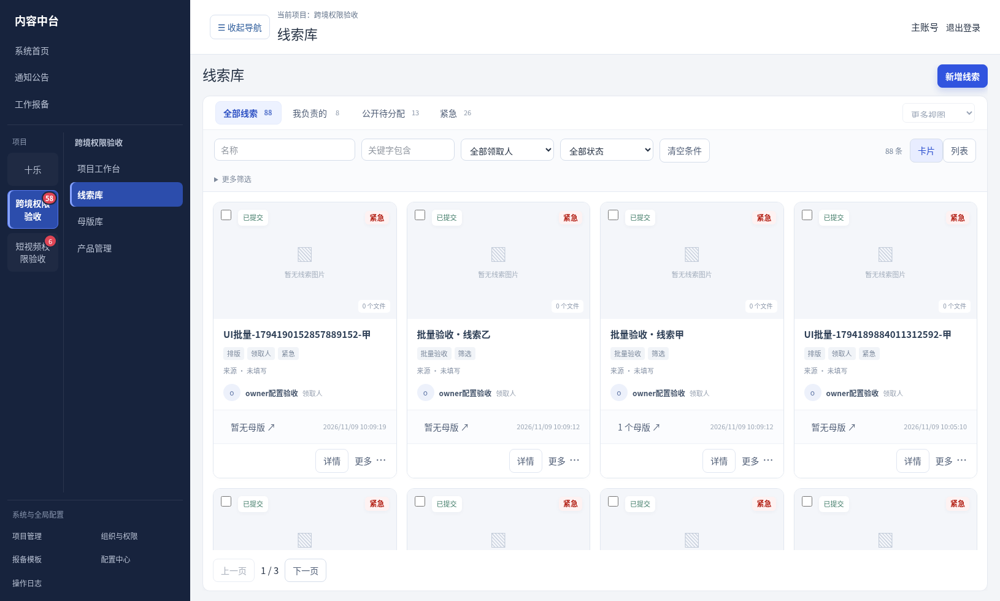
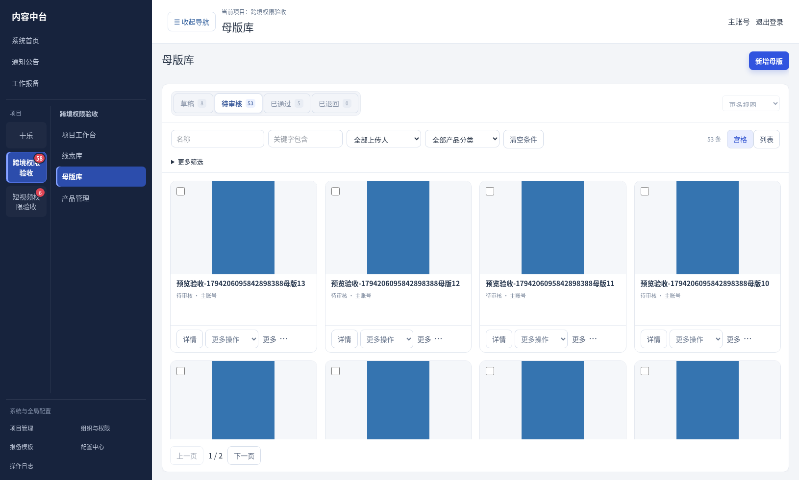

# V3.29.2 页面宽度与卡片排版验收（测试版）

本轮授权：页面两侧留白、主体过窄，以及线索卡片重复边框、信息分散的问题一起修改。

## 改动

- 项目共用内容容器占满导航外的可用宽度，取消重复最大宽度。库页面、详情、通用项目页面沿用各自内部结构；表单字段和阅读区自身限制保留。
- 线索、母版、产品卡片自适应列数，封面保持190px高度并完整显示，原图按需预览；不拉伸图片。
- 线索封面与正文按钮去除全局按钮造成的重复边框／圆角，收紧标题、关键词、来源和领取人信息，领取人称谓统一。关联信息、时间及底部操作对齐分区。
- 保留窗内滚动、筛选、来源返回、多选、预览、未读提醒及权限；无业务逻辑或数据库迁移变化。员工程序版本不变，仅需在线同步新页面后刷新。

## 验证

- 34项浏览器交互回归通过：列表与卡片预览、多图按键、历史图组、审核、本机图片、关联详情返回及删除保护。
- TypeScript、重点范围ESLint及生产构建通过。
- 使用临时测试数据检查1630px宽屏下线索、母版、产品页面及760px窗口，无整页横向溢出。截图为合成测试数据，非正式资料。
- 未运行Windows安装／部署脚本，未进行Windows或Mac实机安装；未部署、未合并默认分支。

