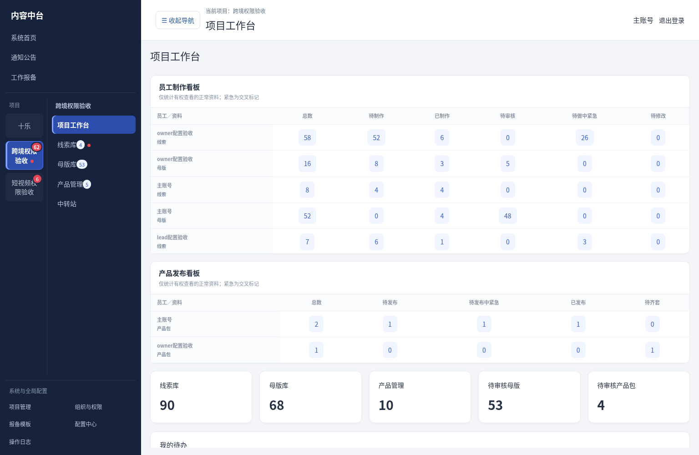
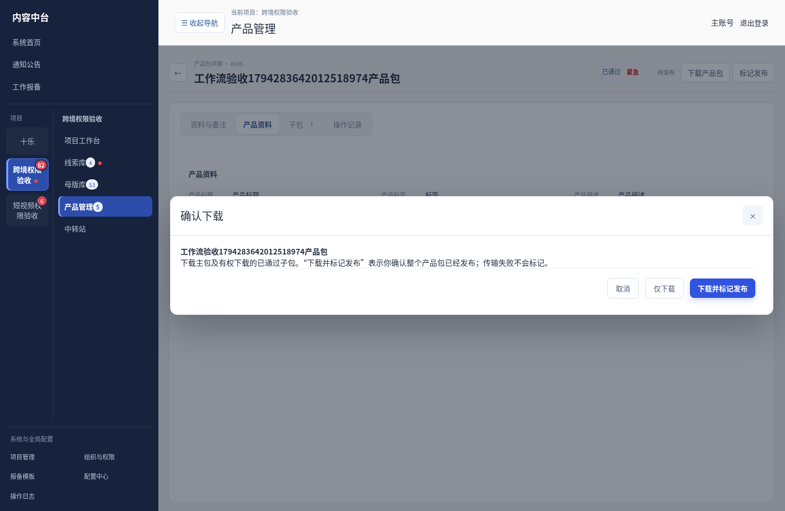
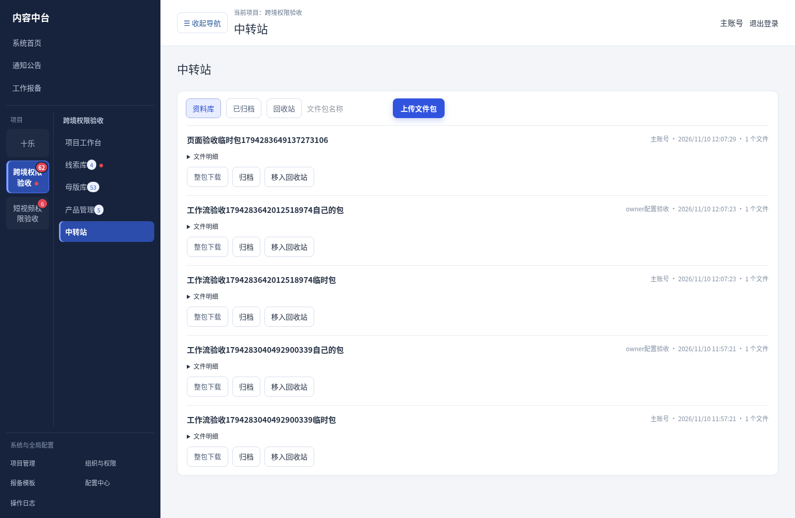

# V3.30.0 制作待办、整包发布与项目中转站（测试版）

## 工作流

线索提交 → 母版制作待办 → 母版提交／审核 → 产品制作待办 → 主包提交／审核 → 子包继承资料、制作／审核 → 整包发布。

不增加线索审核，不自动生成空母版。待操作按实际权限、任务归属和状态计算；同一账号兼任多个职能时合并待办，紧急为交叉标记不重复累计。线索、母版的已制作以存在有效下游提交为依据，待审核独立；被退回工作在对应制作人待修改中出现。来源有其他未提交／退回下游时，不因部分提交清空其紧急标记。

正常资料在全部入口查看，归档与回收分开。悬浮制作看板需看板权限，可隐藏、重开，工作台同口径展示；发布看板需发布权限。看板数字携带员工、类型、状态条件跳转，返回保留筛选和现场。列表及看板每15秒更新，导航5秒更新，主机不可达时不承诺实时更新。导航红点表示未读，数字表示待操作，查看更新不等于完成工作。

主包和各子包独立记录制作人；管理员有分配权限时可调整，实际创建人／上传人留存。分配只开放该任务及必要母版／主包的范围，不开放无关内容、其他项目或移交后的旧线索；项目长、页面权限及项目总开关继续分别校验。

## 产品资料与发布

产品资料位于详情第二个页签。子包提交前要求产品标题、描述，标签选填；可继承主包或单独填，提交存独立快照。保存草稿不要求填全。主包仍须审核通过；历史已通过内容不清空。

仅整个产品包维护已发布、发布人和时间；子包不单独发布，也不累计发布数量。发布包含必要查看、下载，取消发布另授权、必填原因并保留历史。主包及正常子包均通过审核、有完整查看范围时可发布。整包组合的版本和状态变化后，旧标记不代表新组合，但历史日志保留。发布为人工确认，不自动调用外部平台。

下载确认默认仅下载，可选择下载并标记整包发布，也可直接确认已发布。下载确认凭证两分钟、单次使用，绑定账号／项目／资料修订；下载前和读取文件时再校验。流式传输结束才标记，失败／缺文件／修订变化不标记。下载日志区分开始与服务端传输完成，不能据此证明客户端已保存。单子包下载、原有批量下载不改变整包发布状态。

## 中转站

两个项目类型均可按项目配置临时文件包权限；普通成员按本人资料范围，项目长在有查看权限时查看项目范围。查看文件明细与下载原件分开，查看不自动授予下载。支持拖入／多选文件按包上传、整包及单文件下载、归档／取消归档、回收／恢复（从归档删除则恢复为归档）。

每包100个文件、合计5GB，单文件512MB。超过ZIP32交付体积的包需要分次下载文件；不会自动解压、到期清理或混入正式制作统计。上传失败保留已落盘部分，当前窗口可继续同包；未完整传完的文件不入库。中转站上传和下载需主机在线，不承诺离线缓存此类原件。文件名和原件均按权限检查，原件以附件提供，不在仅查看权限下暴露下载地址。

## 更新与验证

新增0049迁移；备份数据库和媒体后更新主机。无需为本轮功能重新安装现有员工端，在线完成页面同步后刷新使用。新权限通过组织与权限中项目角色／员工配置授予，不自动放大旧授权。旧员工队列文件保留；子包缺产品资料时需在新页面补齐再提交。

临时数据库及合成文件验证：

- 92项定向回归：制作／权限／归档删除／批量／ZIP流／离线队列等。
- 90项接口检查：流转、不同制作人、继承必填、发布及取消、一次性下载、权限拒绝、中转站归档恢复与下载隔离。
- 24项生产浏览器检查：看板数字筛选、隐藏、详情返回、产品资料页签、取消发布原因、下载确认、中转站上传和760px窗口；无页面运行错误。
- TypeScript、重点范围ESLint及生产构建通过。

未执行Windows安装／部署脚本；未进行Windows／Mac实机安装验收，未部署、未合并默认分支。此前排查的员工缩略图缓存修复仅为源码提交，本次没有发布新的员工端二进制包。

