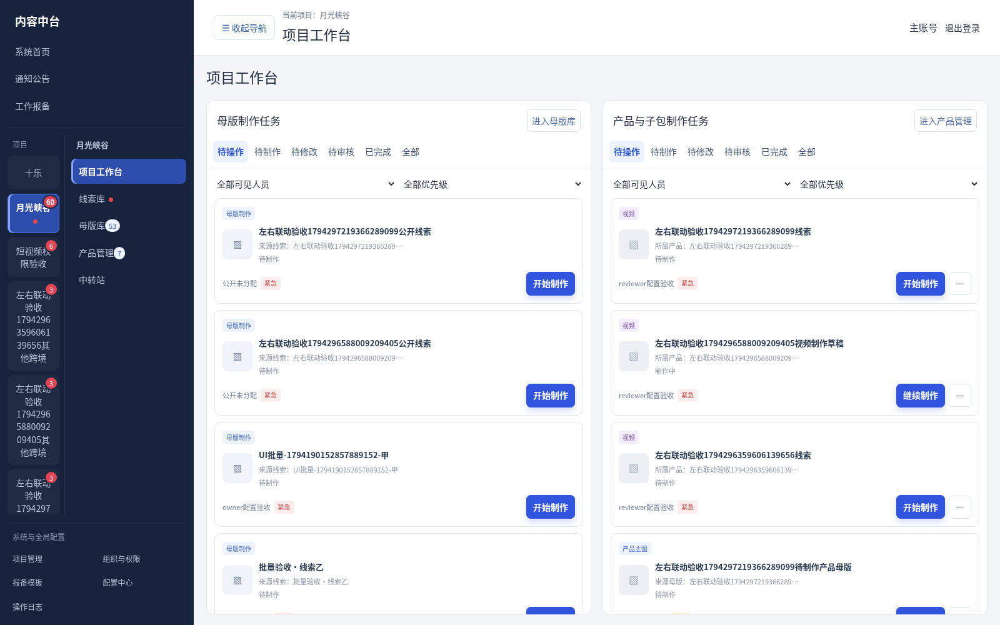
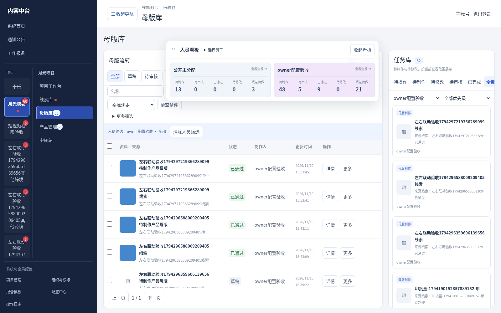
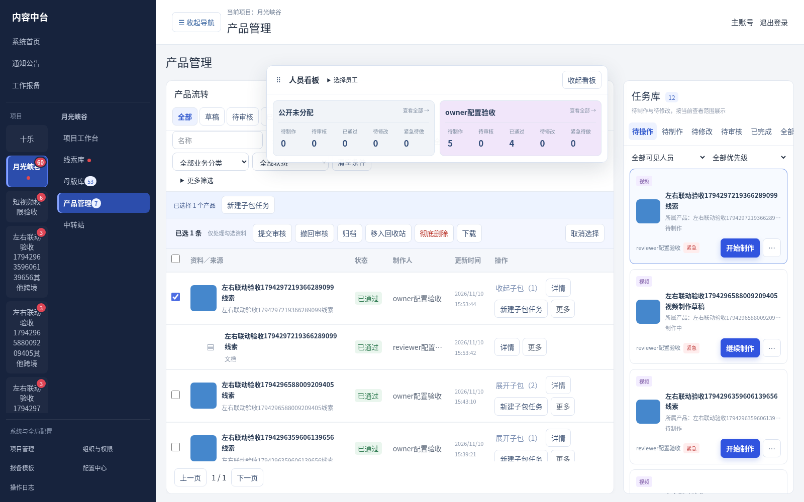
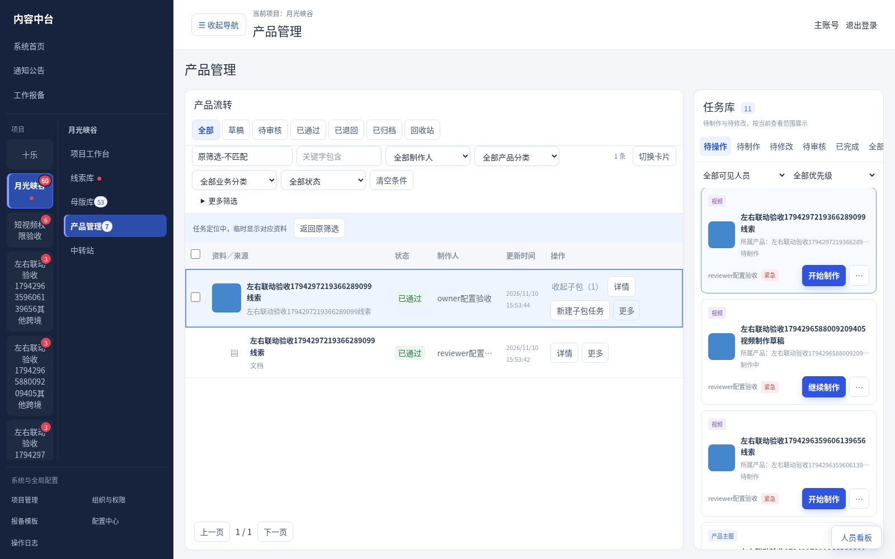

# V3.31 项目任务联动与人员看板验收（测试版）

本轮按用户“可以制作了”及“项目工作台一起改了，只看两个页面任务，按范围”实施，覆盖此前只看样板的讨论阶段。未部署，未合并默认分支。

## 启用与隔离

新增0050迁移。仅在存在唯一跨境项目“月光峡谷”时自动为该项目启用任务工作区，按项目ID持久化。其他项目不自动启用，短视频及未启用跨境项目沿用原界面和流程。若项目已改名、名称重复或未匹配，由主账号进入组织与权限→项目配置→选择项目→当前项目任务工作区确认开关；其他管理员不能配置该开关。开关不代替项目水龙头、页面权限及记录查看范围。

## 主要行为

- 母版库、产品管理：左侧实际成果及流转状态，右侧任务库，两区分别滚动；待制作来源不混入成果。点击任务定位已有成果，子包定位主产品并展开已有子包。无成果时弹出来源详情，不创建空资料；开始制作／继续修改另设按钮。
- 定位时保留原筛选并明确提示定位上下文，可恢复；反向选择成果筛出对应任务。详情返回保留页签及滚动现场。
- 线索、母版、产品人员看板可悬浮、拖动、收起，勾选展示人员，包含公开未分配；人员使用稳定淡色背景。数字点击联动筛选，所有计数按当前账号可见范围计算。
- 线索显示未完成量和普通／优先／紧急数量；母版显示待制作、待审核、已通过、已退回及紧急待制作来源；产品显示产品及子包任务状态。提交后不再显示紧急待做，退回恢复；工作草稿随来源优先级调整。
- 项目工作台只展示母版制作任务和产品／子包任务两个区域，按账号权限范围展示和操作；侧栏数字兼容任务、审核及原有备注更新。
- 已提交线索产生母版任务，审核通过母版产生产品任务；点击查看不创建结果。退回沿原任务及原资料修改，再提交沿版本流程，重复请求不重复建任务或成果。
- 启用项目一份母版仅一个主产品，包括归档和回收占用；既有多产品保留，不合并删除。原主产品可修订版本。未启用项目保持旧数量规则。
- 已通过正常主产品可单条／批量创建子包任务，选择有效非主图分类、负责人、优先级；同分类允许多个独立任务。来源、类型锁定，重新检查权限与状态。可带原因取消尚未开始的子包任务。
- 发布仍以整包为单位，未完成子包任务会阻止发布，包括尚未上传资料的任务。单纯将历史子包关联进任务库不改变既有发布状态；新增待做内容或实际版本变化才要求重新确认。
- 各阶段负责人分开维护，任务交接不改创建人及历史操作人；不因历史母版任务重新开放已移交线索当前资料。文件、来源、私密文档及项目总开关继续校验。

## 员工端兼容

主机更新即可，现有正常运行Windows1.3.2／Mac1.3.0员工端无需重复安装。在线重新进入页面获取新内容。离线必须先在线登录、缓存相应页面、来源和任务；本轮不会使未缓存内容离线可用。离线草稿保留任务身份，回主机同步关联原任务；本地已有待同步草稿显示继续，不重复创建。本版未改员工安装器，不解决旧快捷方式损坏问题。

## 验证

临时数据库和媒体目录验证，未操作正式数据或执行Windows安装／更新脚本。

- 107项原生回归通过，包含15项新增任务测试：隔离、防重、交接、版本、优先级、历史发布保持、取消与发布阻挡、批量失败回滚。
- 109项接口检查、32项生产构建浏览器检查通过，无页面异常；覆盖左右联动、来源弹窗、筛选恢复、工作台、浮动看板、多选、窄屏及其他项目旧界面。
- 已发布Windows1.3.2及Mac1.3.0员工核心代码各4项兼容检查通过（云端执行，不是操作系统实机安装）。
- TypeScript、重点范围ESLint及生产构建通过。Windows／Mac实机安装和正式环境验收仍待执行。

## 页面截图（合成测试数据）

