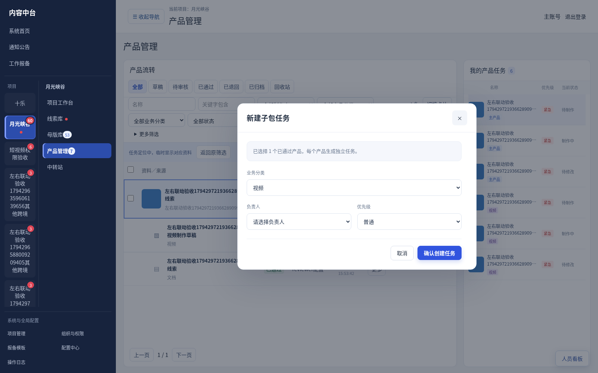
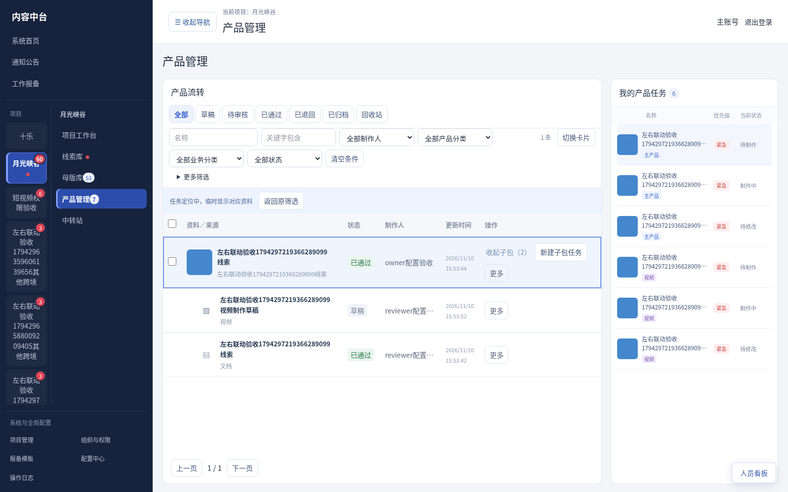

# V3.31.1 个人任务导航与弹窗验收（测试版）

- 母版库右侧标题为“我的线索任务”；产品管理右侧为“我的产品任务”。只显示分配给当前账号的待制作、制作中、已退回和等待同步任务。取消卡片及人员、状态筛选；浮动人员看板与工作台保持原查看范围。
- 每条一张来源封面、一个来源名称、优先级、状态。产品任务增加主产品或具体子包业务分类标签。悬浮缩略图预览，点击沿用定位／来源详情规则。公开未分配、他人、待审核及已完成不显示在个人导航中。
- 目标项目的线索、母版、产品条目取消独立详情按钮；点击条目、卡片正文或键盘Enter进入详情。预览、勾选、更多操作及子包展开不误开详情。审核入口保留。
- 公共CenterDialog统一标题、尺寸、间距及表单控件样式，媒体／表格保留大窗。子包任务弹窗紧凑显示，分类一行、负责人和优先级对齐；窗口内滚动、操作区及窄屏适配保留。其他项目未改任务或流程。

TypeScript、重点ESLint与生产构建通过。临时数据生产浏览器检查包含合成的本人／他人／未分配任务、状态过滤、母版及产品／子包标签、悬浮预览、定位、子包任务弹窗、窄屏及条目进入详情；没有执行Windows实机安装或正式部署。V3.31的107项回归等是前版结果，本轮未全量重跑。旧的scoped-cross-tasks.browser.py保留V3.31交互基线，本轮使用personal-task-navigation.browser.py验证最新个人导航。

现有正常运行员工端无需重装。备份数据库及媒体后，在主机执行Update.cmd更新。

