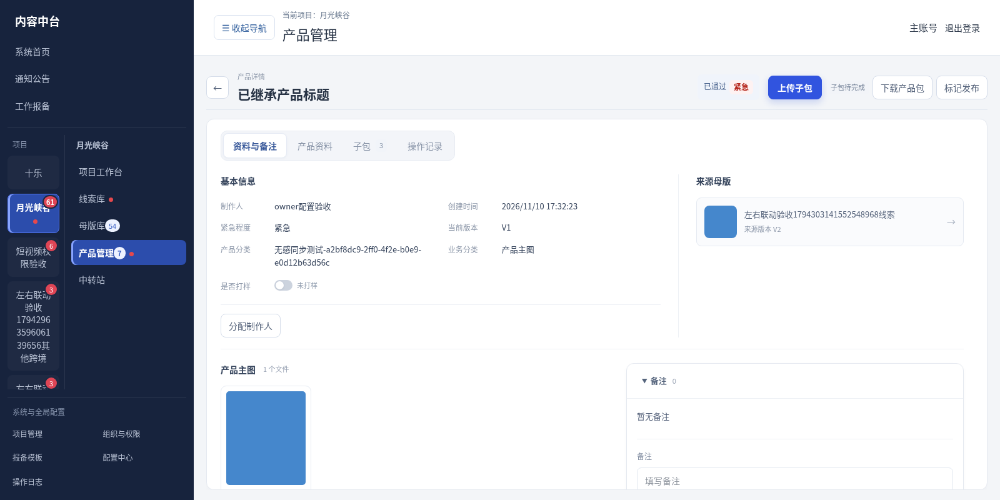
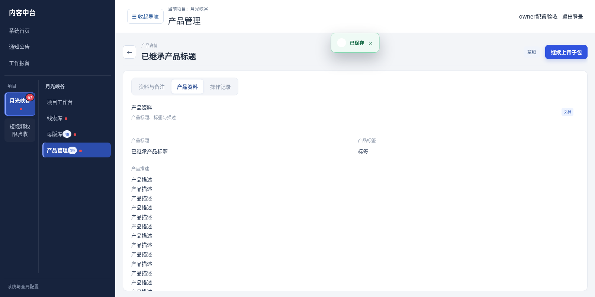
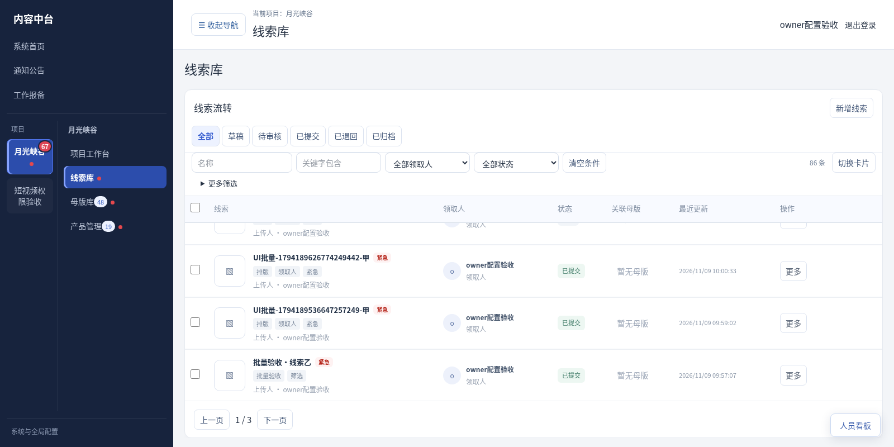
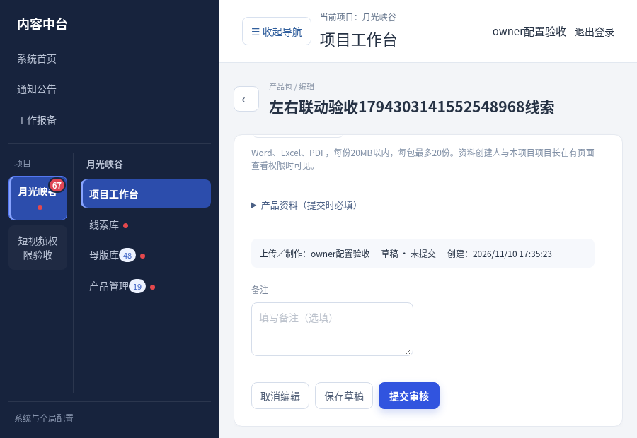

# V3.31.2 滚动布局与子包上传验收（测试版）

用户已授权集中修改，包含之后追加的菜单收起与详情层级调整。未部署、未合并默认分支。

## 界面修复

- 目标跨境项目线索库由外层列表区统一滚动，内层表格取消重复纵向滚动。保留固定筛选区、表头和底部分页。
- 详情和编辑工作区占满可用内容宽度，解除旧居中容器的收缩宽度。头部返回按钮独立固定在内容滚动区上方；详情由Tab内容区滚动，编辑由表单区滚动，长内容及低高度窗口能够到达底部备注、保存和提交。
- 详情Tab只切换内部内容，不返回列表。详情框宽度和标题／页签位置稳定，各Tab独立保存内容滚动位置。修正同一资料从详情再进入上传产生重复返回层级的问题，编辑回详情、详情再回原列表。
- 产品详情显示产品名称：优先使用产品资料中的产品标题，未填时回退资料名称，并移除自动生成的末尾“产品主图”后缀；不改数据库名称和历史版本。标题不显示内部编号。“产品主图”在基本信息业务分类及下方文件标题中表达；产品名称→Tab→基本信息→主图／业务文件的层级清楚。
- 产品资料Tab使用标题／标签并列、描述独占一行、制作／发布信息分区。编辑页产品资料也独占区块并对齐字段。
- 列表“更多”菜单点击其他区域自动收起，Escape收起并将焦点返回菜单按钮。
- 补齐任务工作区详情关联资料的跳转监听，主产品→子包／来源详情可进入并沿原层级返回，来源预览弹窗保留独立滚动。

## 子包上传入口与权限

仍先由有分配权限的人为已通过的正常主产品创建子包任务，确定业务类型、负责人及优先级，不绕开任务关系直接生成不明归属子包。

- 项目工作台：产品／子包任务中的“上传子包”。
- 产品管理列表／卡片：主产品行“上传子包”进入可制作子包任务；已有子包可“继续上传子包”。多个任务先选择类型、负责人及任务再进入，单个任务直接进入。
- 详情：主产品详情可选择并上传关联子包；允许编辑的子包详情可“上传子包／继续上传子包”。来源预览为只读，不显示上传操作。
- 右侧“我的产品任务”保留纯列表和定位，同时增加独立上传按钮；母版个人任务也可显式开始／继续制作，不与定位混为同一动作。浮动人员看板筛选左侧成果，不把个人任务导航切换成他人任务。

使用已有项目权限，不新增角色或隐藏授权：新任务需要“制作与提交资料”（cross.create），首次未提交草稿可由制作或编辑权限继续，已有提交版本退回修改需“编辑跨境资料”（cross.edit）。同时校验当前项目总开关、页面及资料范围、任务负责人（有分配维护权限者按原规则维护）、来源正常已通过、业务类型与当前资料状态。分配权限或查看权限本身不代表上传权限。

任务接口与入口使用相同创建／编辑规则；直接文件上传、保存、提交、封面等继续执行服务端权限和锁定校验。重复进入原任务不生成第二份子包，工作台、列表和详情沿用同一结果。

## 验证与更新

- 108项原生回归通过，包含任务权限规则、任务去重、历史来源、发布、离线队列、删除及流式下载。
- 109项接口检查通过；77项生产构建浏览器检查通过，无页面异常。覆盖只读账号禁用上传入口、越权任务启动和撤权后直接文件上传拦截、三个位置上传及继续、详情返回、Tab切换与滚动位置、主产品及子包分类、线索单滚动区、线索／母版／子包长内容、低高度编辑窗口、来源弹窗、菜单外部点击与Escape。
- TypeScript、重点范围ESLint及生产构建通过。全部在临时数据库与媒体目录验证，未操作正式数据、未运行Windows安装／更新脚本；Windows／Mac实机仍待验收。

仅更新主机即可，正常使用的员工端无需重装。先备份主机数据库与媒体目录，再解压运行Update.cmd；员工在线重新进入／刷新系统获取页面更新。目标项目任务工作区的启用范围沿用V3.31，不自动启用其他项目。

## 截图（合成测试数据）

