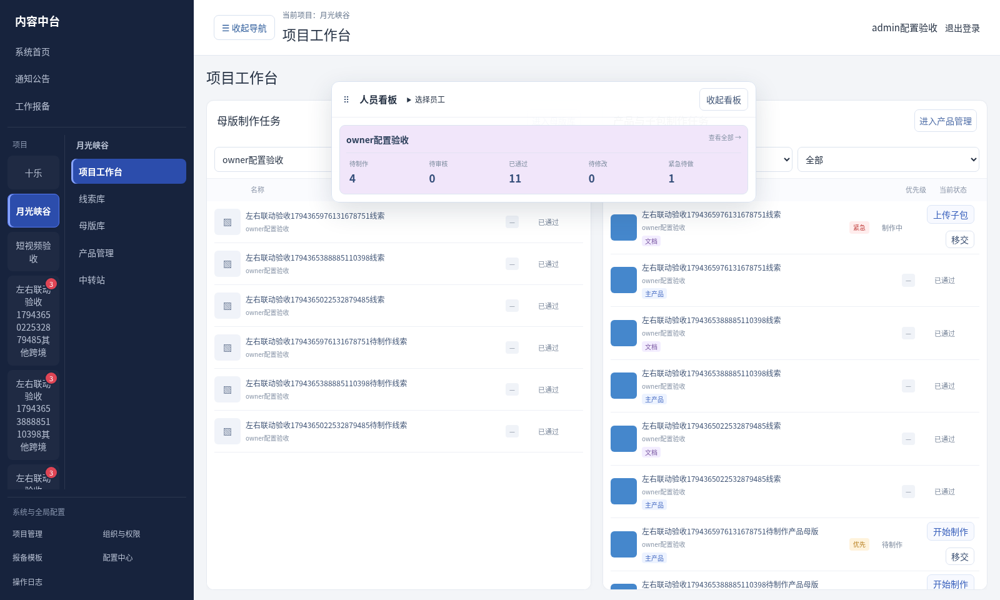
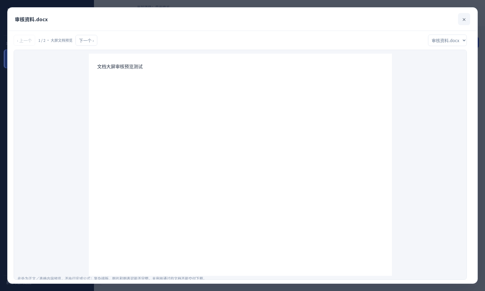
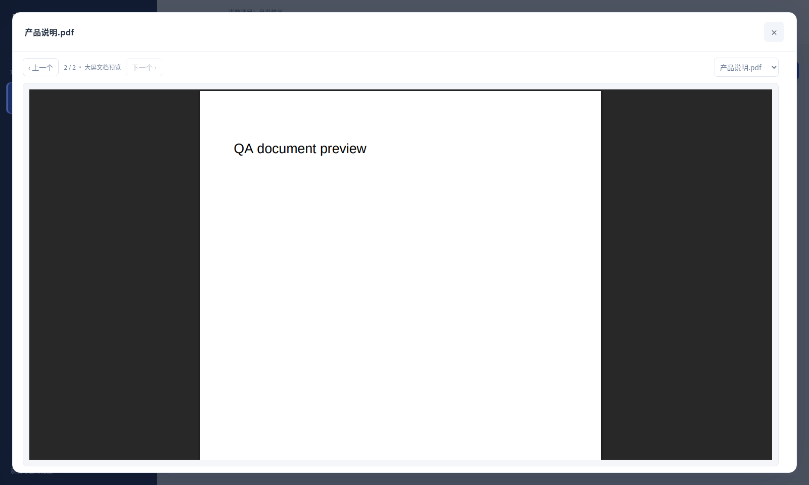
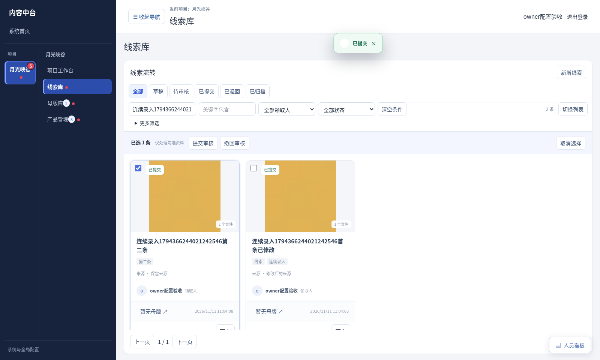
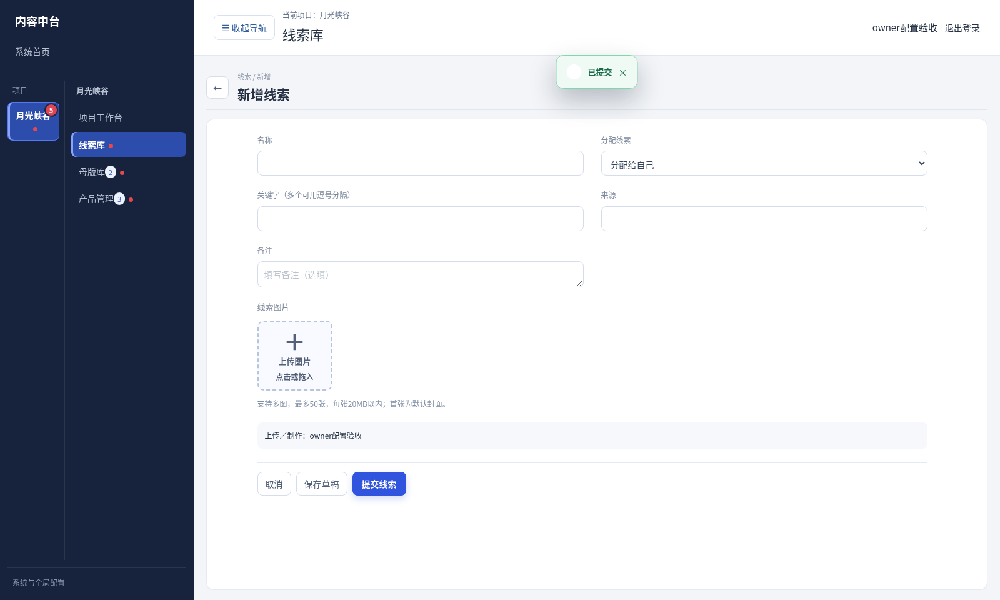

# V3.31.3 文档审核发布与线索连续录入验收（测试版）

2026-11-11 按用户“修改”及本轮追加要求实施。未部署，未合并默认分支；未运行Windows安装／更新脚本。数据和附件验证全部使用临时目录。

## 工作台及列表

- 当前启用的跨境任务工作区，项目工作台的两类任务改为紧凑列表，保留范围／状态筛选、类型、人员、优先级、状态和必要操作。已通过／待审核不再显示遗留紧急标记，个人导航仍只显示本人待做／退回任务。
- 工作台也接入人员悬浮看板，含公开未分配、人员勾选和状态／紧急计数。看板按当前资料查看范围统计；权限仍为项目cross.board，不自动向无权限账号开放。人员数字可联动两类任务筛选，看板可收起、重新展开和拖动。
- 产品管理行内／卡片的“上传子包”和“新建子包任务”收入“更多”，批量任务入口按选择保留；“子包”按钮显示上下箭头、数量及aria-expanded。个人任务和工作台保留制作入口。菜单保持点击外部／Escape关闭。
- 修复线索宫格中封面、标题、负责人区域没有撑满卡片以及内部按钮边框割裂的问题：复用已确认的卡片样式，封面完整展示、信息与底部操作对齐；勾选层独立定位，菜单打开时不被卡片裁切。列表单滚动区继续保留。

## 文档审核、交付及发布

- 文档子包详情、列表封面位置和审核弹窗均可进入大屏文档预览。窗口覆盖可用屏幕，独立滚动；支持上一份／下一份、下拉选择及键盘左右键（输入控件或PDF自身获得焦点时不抢占其键盘）。关闭预览后回到原审核窗口，不关闭审核流程。
- PDF使用浏览器原生预览；DOCX／XLSX使用现有本地正文／表格解析，不执行宏或公式，复杂排版、图片、图表与数字格式不保证完整。旧DOC／XLS沿用主机LibreOffice转换为PDF；主机未配置组件时显示明确提示。本版不自动安装转换组件，也未进行其Windows实机验证。
- 审核预览沿用项目、页面及文件查看范围，不自动扩大审核人的资料范围；跨境预览窗口不提供“下载原件”，预览不授予交付下载权限。普通报备附件默认下载方式保持原样。
- 当前任务工作区存在正常使用且尚未通过的文档子包，或尚未上传的文档类型任务时，所属主产品不可交付下载、不可发布。涵盖草稿、待审核、已退回，按业务分类媒体类型识别，不仅检查固定document代码。归档／回收及已取消任务仍按原规则排除。
- 整包下载请求、旧式直接下载、下载确认、批量预检及实际流式下载均校验；不得静默跳过未通过文档后仍下载主包。显式原件下载要求cross.download并校验审核状态，preview与download同时传入也不能绕过。数据或审核状态在流式读取时变化会终止交付。
- 文档子包通过审核后，整包显示“待发布”；有权限的人标记发布才显示“已发布”。子包不单独发布。新增文档、任务或实际版本变化会使旧整包发布签名失效，不自动冒充新内容已发布；重复读取不反复写审核事件或取消有效发布。
- 其他未完成子包仍会阻挡整包发布，文档通过不绕过这些规则。发布仍要求cross.publish，包含必要下载权限。返回上级详情时重新读取数据，避免显示文档审批前的旧发布状态。

## 线索提交

- 从新建页面提交线索成功后进入新的空白线索表单，名称、关键字、来源、附件和备注重新初始化，方便连续录入；只打开表单，不预先创建空记录。
- 从编辑入口修改已有线索后提交（含已有未提交草稿），重新读取并展示该线索详情；退出保留原列表筛选。嵌套详情返回链继续保留。
- 校验失败或附件上传失败不清空输入和待上传文件，保留编辑状态；部分写入后重试继续原草稿，不重新创建重复线索。
- 员工本机模式沿用原队列协议：成功保存本机提交后可继续下一条，提示连接后同步；不将本机保存冒充主机已收到。正常使用员工端无需重装。

## 验证

- 110项主要原生回归通过；19项报备附件／旧Office转换单元及路由测试通过。
- 109项任务与权限接口检查通过；86项文档／工作台生产浏览器检查、36项线索连续录入／卡片浏览器检查通过，无页面异常。
- 12项独立Office解析浏览器检查通过；PDF原生渲染已观察到测试页内容。类型检查、生产构建及重点ESLint检查通过；公共旧组件已有lint问题未扩大，改动无新增问题。
- 未部署、未执行Windows／Mac实机安装；旧DOC／XLS转换测试使用受控测试转换器，不代表已在用户主机安装LibreOffice。

## 更新

先备份主机数据库和媒体目录，解压主机包运行Update.cmd。正常员工端无需重复安装，在线重新进入／刷新页面获取新界面。新增任务页面仍按V3.31项目开关启用，不自动为其他项目启用。短视频流程未改动。

## 截图（合成测试资料）

