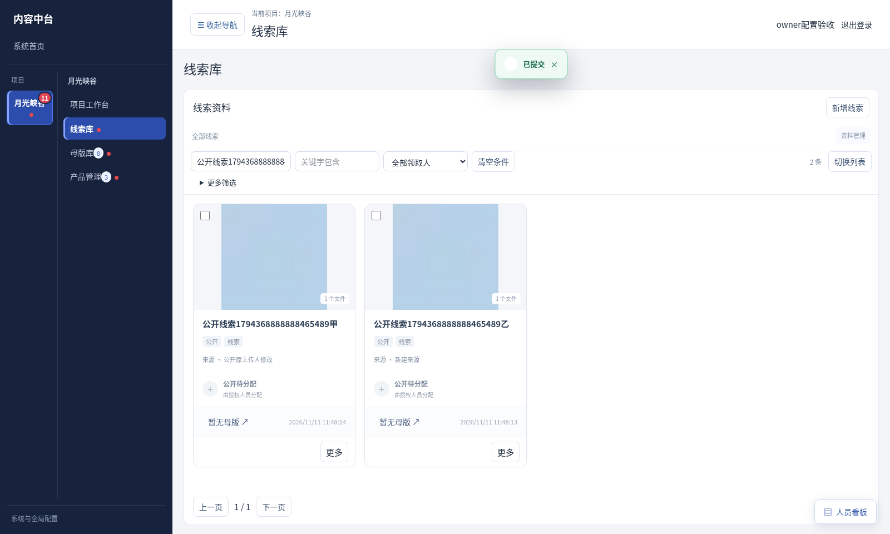
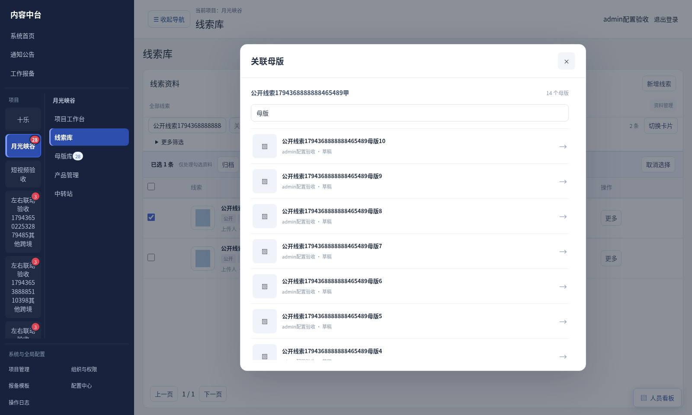
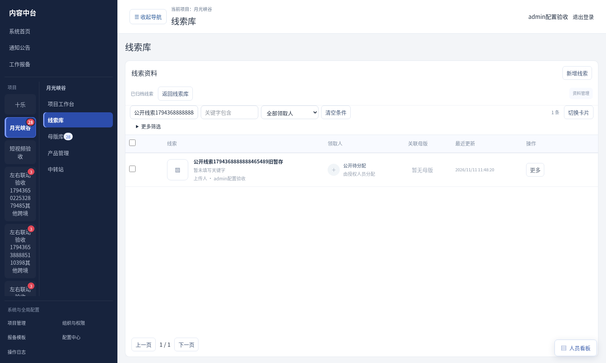

# V3.31.4 首页恢复与线索简化（主机测试版）

2026-11-11，用户确认主机网页异常后授权“那就一起加进去”，本版合并首页加载补丁与已记录的线索新规则。未部署、未合并默认分支，未运行Windows安装／更新脚本。

## 首页加载恢复

- 接口响应为空、截断JSON、HTML错误页或网络断开时显示中文提示、具体接口路径及可用HTTP状态，避免直接显示JSON解析异常。
- 仅GET读取有限重试一次，401／403不重复请求；写入响应不完整时不自动重发，避免重复新建。保留业务错误及dependencies等数据。
- 项目列表和账号信息分别更新，任一失败不丢弃另一方成功数据。恢复后清除旧错误；保留后台重读并提供重新加载按钮，旧请求的迟到结果不覆盖新结果。
- 截图无法确定真实主机产生空响应的后端根因。本版修复已确认的前端错误处理与恢复缺口，不保证消除未知服务／数据库故障。持续失败需结合安装目录logs/server-error.log、server-output.log定位。

## 线索新建与编辑

- 新建表单默认“公开”，第一项公开，不再提供单独“分配给自己”；有原分配资格的项目长可选其他项目成员，候选不含自己。普通成员新建默认公开；连续录入下一条也重置公开。旧分配人与历史数据不改写。
- 从新建页提交成功后进入空白表单；从编辑入口提交后回到刷新详情，返回保留原现场。无改动提交正常返回，不额外产生版本。失败保留输入和附件，重试复用原暂存记录。
- 列表、卡片、详情及编辑不展示线索业务状态；取消线索状态页签／筛选、草稿保存按钮、批量提交／撤回审核。只有一个提交线索操作，修改内容仍保留版本追溯，备注独立追加。
- 上传与离线同步仍需内部暂存及版本字段，以保证失败重试、幂等和旧客户端兼容；它们不再作为员工可选的草稿／审核流转。已有未完成线索在正常资料中可继续编辑，不丢弃旧草稿或待同步任务。母版与产品审核流程保持原规则。
- 公开未分配线索由原上传人在有编辑权限、未被母版引用时维护；其他查看者不会因此获得编辑或分配权。线索移交后仍按领取人范围处理，历史母版归属不转移。

## 列表、分配和关联母版

- 普通条目点击进入详情。领取人区域在有分配权限时是快捷入口，点击只开分配弹窗，不同时进入详情；无权限不显示可操作分配控件。
- 归档与回收站收入次要“资料管理”菜单，默认正常资料。进入管理视图读取最新数据；保留归档、回收、恢复及权限校验，不改变历史关系或恢复位置。旧线索暂存也可按权限归档／回收，不会被隐藏状态困住；有正常下级的限制继续生效。
- 点击关联母版数量／暂无母版，打开按查看权限过滤的母版列表弹窗，提供搜索、缩略图和制作人。点击母版进入详情，退出回原弹窗，保留搜索及滚动；关闭弹窗回原线索列表，保留筛选、勾选和视图。无权查看的母版不列出。
- 未分配的母版制作任务不显示可开始按钮，仍需先由有权限的人分配线索，不自动领取。

## 验证

- 121项原生检查通过：包含首页读取／写入重试区分、公共未分配维护权、移交、旧暂存归档、历史数据、任务、批量、离线及下载回归。
- 74项生产浏览器线索检查通过：默认公开／无自己、连续新建、失败重试、无状态列表和卡片、公共创建人编辑与无改动提交、快捷分配不误开详情、移交权限、母版范围隔离和弹窗返回现场、旧暂存归档。
- 109项接口检查及86项文档／工作台浏览器回归通过，确认线索改动未破坏原母版与产品流程。
- 16项生产浏览器首页恢复检查通过，无页面异常。此前V3.31.3的草稿按钮交互基线由本版新脚本覆盖，不将旧36项脚本当作本版结果。
- TypeScript、重点ESLint无新增问题及生产构建通过。测试仅使用临时数据库和合成会话，未验证用户主机日志、未进行Windows／Mac实机更新。

## 更新

备份主机数据库与媒体目录后，解压运行Update.cmd，完成后重新进入／刷新网页。正常使用的员工端无需重装。新线索页面按当前项目任务工作区开关生效，不自动改其他项目流程。

